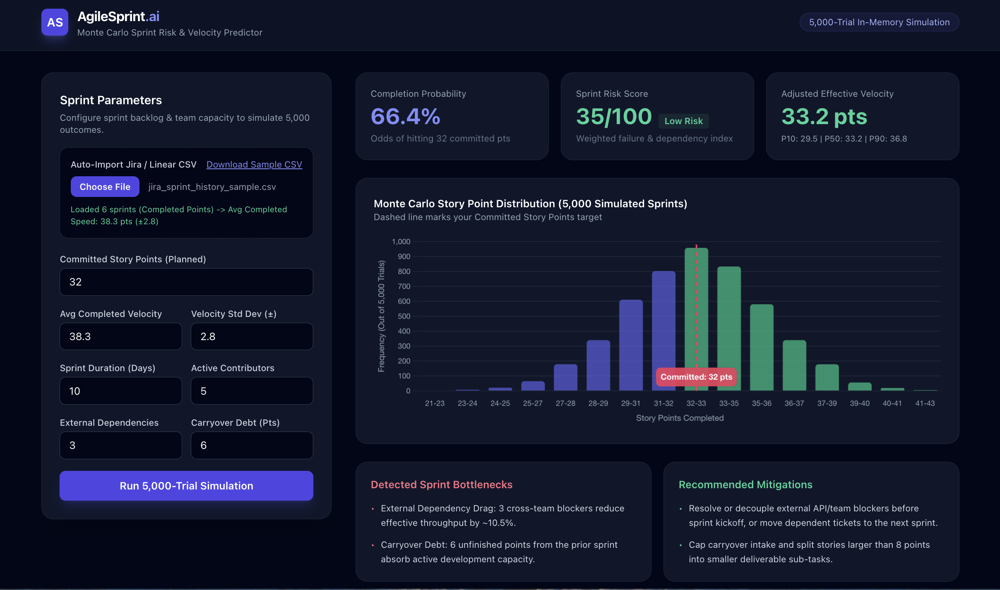

# AgileSprint.ai — Stateless Monte Carlo Sprint Risk & Velocity Predictor


**Live Demo:** [https://agilesprint-ai.onrender.com/](https://agilesprint-ai.onrender.com/)



AgileSprint.ai is a lightweight, zero-storage project operations tool that forecasts Agile sprint completion probabilities, detects delivery bottlenecks, and generates mitigation plans using a 5,000-iteration Monte Carlo simulation engine.

---

## Core Capabilities

* **Monte Carlo Delivery Forecasting:** Models velocity variance, external dependency drag, and carryover debt across 5,000 simulated sprints to calculate P10, P50, and P90 delivery confidence intervals.
* **Automated Bottleneck Diagnostics:** Evaluates scope-to-velocity ratios, dependency density, and per-contributor daily point saturation to pinpoint delivery risks before sprint kickoff.
* **Stateless Privacy Architecture:** All sprint metrics are processed strictly in active server memory and discarded immediately after rendering—zero databases, zero cookies, and zero retention of proprietary team metrics.

---

## System Architecture

```text
[User Browser / Tailwind UI]
        │
        ▼  POST /api/analyze (JSON Sprint Parameters)
[Flask Application Server]
        │
        ▼  In-Memory Vectorized Simulation (NumPy)
[Monte Carlo & Risk Heuristic Engine]
        │  ├── Dependency & Carryover Efficiency Adjustment
        │  ├── 5,000-Run Normal Distribution Sampling
        │  └── Rule-Based Bottleneck & Mitigation Generator
        ▼  JSON Response (Forecasts, Histogram, Action Items)
[Chart.js Interactive Visualization]
